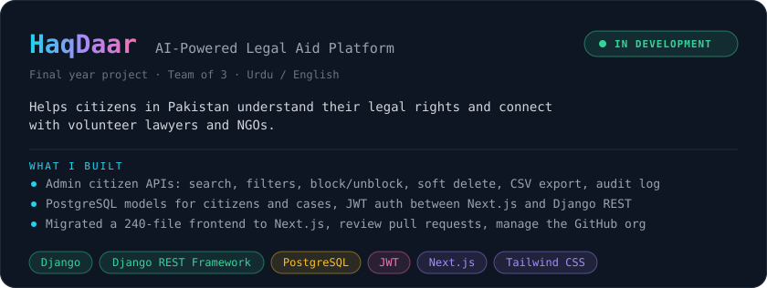
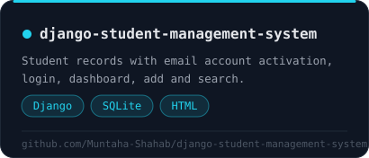
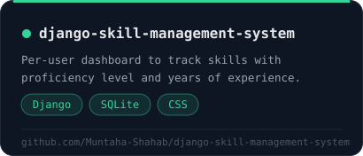
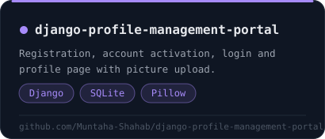
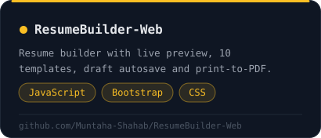
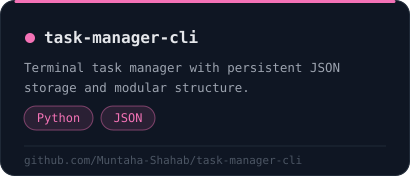
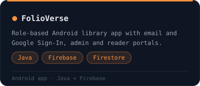
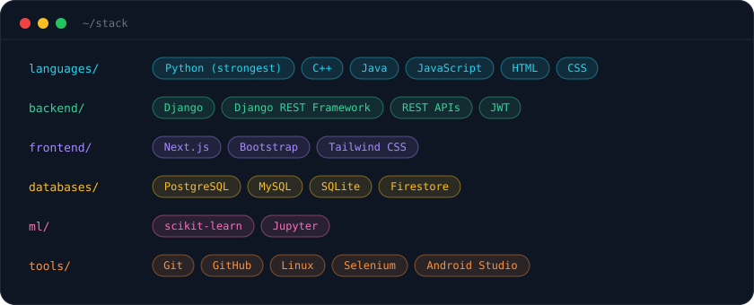

[LinkedIn](https://linkedin.com/in/muntahashahab) &nbsp;|&nbsp; [itsmuntaha010@gmail.com](mailto:itsmuntaha010@gmail.com) &nbsp;|&nbsp; Lahore, Pakistan

Backend developer building secure REST APIs with Python and Django. Open to backend internships and junior roles (onsite in Lahore or remote).

## Featured Project

## Projects

<table width="100%">
  <tr>
    <td width="50%"></td>
    <td width="50%"></td>
  </tr>
  <tr>
    <td width="50%"></td>
    <td width="50%"></td>
  </tr>
  <tr>
    <td width="50%"></td>
    <td width="50%"></td>
  </tr>
</table>

## Tech Stack

## Activity

## Education

**B.S. Software Engineering**, University of Management and Technology (UMT), Lahore. March 2023 to February 2027 (expected).

Certification: JavaScript Mastery Bootcamp, Kohaq (Nov 2025).

## Contact

[LinkedIn](https://linkedin.com/in/muntahashahab) &nbsp;|&nbsp; [itsmuntaha010@gmail.com](mailto:itsmuntaha010@gmail.com)
